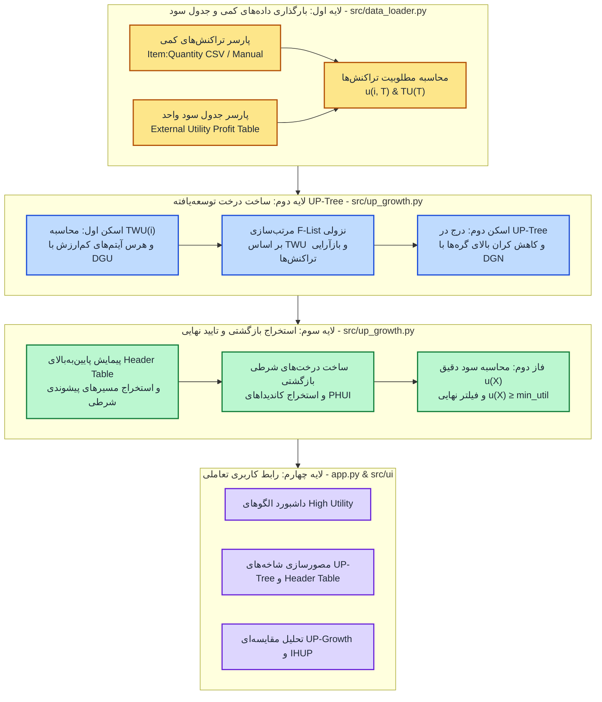
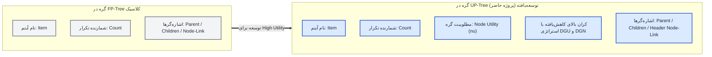

<div align="center">

# 💎 سامانه استخراج الگوهای با مطلوبیت بالا با توسعه الگوریتم FP-Growth
### High Utility Pattern Mining Engine via Extended FP-Growth (UP-Growth & IHUP)

**کشف الگوهای پرسود و با مطلوبیت بالا (HUPM) مبتنی بر درخت توسعه‌یافته UP-Tree، خاصیت بستار TWU و استراتژی‌های هرس DGU و DGN**

[](https://www.python.org/)
[](https://streamlit.io/)
[](https://github.com/)
[](https://github.com/)
[](#-اجرای-تست‌های-خودکار-unit-tests)
[](./LICENSE)

**توسعه‌دهنده:** [Kian Shojaei](https://github.com/KianShojaei) &nbsp;|&nbsp; **پروژه درس:** داده‌کاوی (Data Mining)

</div>

---

## 🎯 معرفی و هدف پروژه

الگوریتم‌های سنتی کشف الگوهای پرتکرار (مانند Apriori و FP-Growth استاندارد) تنها بر **فراوانی وقوع (Support)** آیتم‌ها تمرکز دارند و فرض می‌کنند تمامی کالاها دارای ارزش و سود یکسانی هستند؛ همچنین از تعداد خرید هر کالا در یک تراکنش چشم‌پوشی می‌کنند. در دنیای واقعی، ممکن است یک کالای لوکس یا گران‌قیمت (مانند «لپ‌تاپ» یا «زعفران») دفعات کمتری نسبت به کالاهای روزمره (مانند «نان») فروخته شود و زیر آستانه `minsup` قرار گیرد، اما **سود و مطلوبیت (Utility / Profit)** بسیار بیشتری برای کسب‌وکار ایجاد کند.

مسئله **استخراج الگوهای با مطلوبیت بالا (High Utility Pattern Mining - HUPM)** این محدودیت را با در نظر گرفتن هم‌زمان **مطلوبیت داخلی (تعداد خرید هر کالا در تراکنش)** و **مطلوبیت خارجی (سود واحد هر کالا)** برطرف می‌سازد. این پروژه با توسعه مستقیم ساختار درختی الگوریتم **FP-Growth** به دو الگوریتم استاندارد **IHUP-Growth** و **UP-Growth (Utility Pattern Growth)**، تمامی الگوهایی که مطلوبیت آن‌ها از آستانه $\text{min\_util}$ بیشتر است را بدون تولید کاندیداهای مرحله‌به‌مرحله استخراج و مصورسازی می‌کند.

---

## 🎥 ویدیوی دموی محیط برنامه (Project Demo Video)

در ویدیوی زیر می‌توانید نحوه کارکرد سامانه، ساخت درخت توسعه‌یافته `UP-Tree`، جدول هدر مرتب‌شده بر اساس `TWU`، مقایسه اثر هرس `DGN` در کاهش کاندیداها و کشف الگوهای پرسود را مشاهده فرمایید:


https://github.com/user-attachments/assets/5d02950b-ed58-4057-962f-a5b10d5d3eb3


<div align="center">
  <video src="https://github.com/KianShojaei/fpgrowth-high-utility-miner/raw/main/Video/demo.mp4" width="95%" controls autoplay loop muted></video>
  <br/>
  <p>🎬 <b><a href="https://github.com/KianShojaei/fpgrowth-high-utility-miner/raw/main/Video/demo.mp4">▶️ مشاهده یا دانلود مستقیم ویدیوی دموی پروژه (Video/demo.mp4)</a></b></p>
</div>

---

## 📌 معماری کلان سیستم (System Architecture)

سامانه بر پایه معماری ماژولار ۴ لایه پیاده‌سازی شده است:



---

## 📐 مبانی ریاضی و چالش توسعه FP-Growth برای High Utility

### ۱. تعاریف پایه ریاضی
فرض کنید $\mathcal{I} = \{i_1, i_2, \dots, i_m\}$ مجموعه کل آیتم‌ها و $\mathcal{D} = \{T_1, T_2, \dots, T_n\}$ پایگاه داده تراکنش‌های کمی باشد:

* **مطلوبیت داخلی (Internal Utility - $q(i, T_d)$):** تعداد (Quantity) خرید آیتم $i$ در تراکنش $T_d$.
* **مطلوبیت خارجی (External Utility - $p(i)$):** سود واحد (Unit Profit) حاصل از فروش هر واحد از آیتم $i$.
* **مطلوبیت آیتم $i$ در تراکنش $T_d$:**

$$u(i, T_d) = q(i, T_d) \times p(i)$$

* **مطلوبیت مجموعه آیتم $X$ در تراکنش $T_d$ (به شرط $X \subseteq T_d$):**

$$u(X, T_d) = \sum_{i \in X} u(i, T_d)$$

* **مطلوبیت کل الگوی $X$ در کل پایگاه داده $\mathcal{D}$:**

$$u(X) = \sum_{X \subseteq T_d \in \mathcal{D}} u(X, T_d)$$

الگوی $X$ یک **الگوی با مطلوبیت بالا (High Utility Pattern - HUP)** نامیده می‌شود اگر و تنها اگر $u(X) \ge \text{min\_util}$ باشد.

---

### ۲. چالش اصلی: چرا FP-Growth استاندارد در اینجا شکست می‌خورد؟
در الگوریتم FP-Growth استاندارد، هرس کردن شاخه‌ها متکی بر خاصیت **بستار رو به پایین (Downward Closure / Anti-Monotonicity)** روی معیار Support است؛ یعنی برای هر $X \subset Y$ داریم $\text{sup}(X) \ge \text{sup}(Y)$.

**اما در مسئله High Utility این خاصیت برقرار نیست!** برای یک زیرمجموعه $X \subset Y$، مطلوبیت $u(X)$ می‌تواند **کوچک‌تر** از $u(Y)$ باشد ($u(X) < u(Y)$). بنابراین اگر در درخت FP-Tree آیتم‌ها را بر اساس سود خودشان حذف کنیم، بسیاری از الگوهای با مطلوبیت بالا از دست می‌روند.

---

### ۳. راه‌حل: قضیه بستار رو به پایین وزن‌دار تراکنش (TWU Downward Closure)
برای بازگرداندن خاصیت بستار رو به پایین به ساختار درختی FP-Growth، دو مفهوم زیر تعریف می‌شوند:

1. **مطلوبیت کل تراکنش (Transaction Utility - $TU(T_d)$):** مجموع سود تمام آیتم‌های موجود در تراکنش $T_d$:

$$TU(T_d) = \sum_{i \in T_d} u(i, T_d)$$

2. **مطلوبیت وزن‌دار تراکنش برای الگوی $X$ ($TWU(X)$):** مجموع $TU$ تمامی تراکنش‌هایی که شامل الگوی $X$ هستند:

$$TWU(X) = \sum_{X \subseteq T_d \in \mathcal{D}} TU(T_d)$$

**قضیه (TWU Anti-Monotonicity):** برای هر دو الگوی $X \subseteq Y$ همواره روابط زیر برقرار است:

$$u(X) \le TWU(X) \qquad \text{و} \qquad TWU(Y) \le TWU(X)$$

**نتیجه حیاتی برای هرس درخت:** اگر $TWU(X) < \text{min\_util}$ باشد، آنگاه نه خودِ $X$ و نه **هیچ ابرمجموعه‌ای از $X$** هرگز نمی‌تواند یک الگوی High Utility باشد!

---

## 🌳 نحوه توسعه FP-Growth به الگوریتم‌های IHUP و UP-Growth

در این پروژه، ساختار گره‌های درخت `FP-Tree` به درخت **`UP-Tree` (Utility Pattern Tree)** ارتقا یافته است:



### استراتژی‌های بهینه‌سازی پیاده‌سازی‌شده در `HighUtilityFPGrowthMiner`:

1. **استراتژی DGU (Discarding Global Unpromising Items) در اسکن اول:**
   * در اسکن اول دیتابیس، $TWU(i)$ برای تمام آیتم‌ها محاسبه می‌شود.
   * آیتم‌هایی که $TWU(i) < \text{min\_util}$ دارند از تراکنش‌ها حذف می‌شوند و سود آن‌ها نیز از $TU$ تراکنش کسر می‌گردد تا **مطلوبیت تراکنش بازآرایی‌شده ($RTU$)** به دست آید.
   * آیتم‌های باقی‌مانده به ترتیب نزولیِ $TWU$ در جدول هدر (**Header Table / F-List**) مرتب می‌شوند.

2. **استراتژی DGN (Discarding Global Node Utilities) در اسکن دوم هنگام ساخت درخت:**
   * **حالت اول (`IHUP-Growth`):** در هر گره از مسیر درج تراکنش، کل مقدار $RTU(T_d)$ به `node_utility` اضافه می‌شود.
   * **حالت دوم (`UP-Growth با DGN`):** هنگام درج یک تراکنش مرتب‌شده $T'_d = \langle i_1, i_2, \dots, i_k \rangle$ در درخت، برای گره مربوط به آیتم $i_r$، سود تمامی آیتم‌های بعدی در مسیر ($i_{r+1}, \dots, i_k$) کنار گذاشته می‌شود و تنها مجموع سود پیشوند تا آن گره به `node_utility` افزوده می‌شود:

$$nu(i_r) = nu(i_r) + \sum_{j=1}^{r} u(i_j, T_d)$$

3. **استخراج بازگشتی درخت‌های شرطی (Conditional UP-Trees) و تایید نهایی:**
   * جدول هدر از پایین به بالا پیمایش می‌شود. برای هر آیتم پایه، اگر مجموع `node_utility` گره‌های زنجیره آن بزرگ‌تر یا مساوی $\text{min\_util}$ باشد، مسیرهای پیشوندی استخراج شده و درخت شرطی آن ساخته می‌شود.
   * در پایان، برای کاندیداهای استخراج‌شده (PHUIs)، سود دقیق $u(X)$ محاسبه شده و الگوهای با $u(X) \ge \text{min\_util}$ برگردانده می‌شوند.

---

## 📂 ساختار درختی پروژه (Project Structure)

```text
fpgrowth-high-utility-miner/
├── Video/
│   └── demo.mp4                          # ویدیوی کامل دموی محیط برنامه
├── data/                                 # دیتاست‌های کمی و جداول سود واحد
│   ├── benchmark_upgrowth.csv            # تراکنش‌های دیتاست استاندارد UP-Growth
│   ├── benchmark_upgrowth_profits.csv    # جدول سود واحد دیتاست استاندارد
│   ├── electronics_store.csv             # تراکنش‌های فروشگاه کالای دیجیتال
│   ├── electronics_store_profits.csv     # جدول سود واحد فروشگاه دیجیتال
│   ├── supermarket_utility.csv           # تراکنش‌های سوپرمارکت
│   └── supermarket_utility_profits.csv   # جدول سود واحد سوپرمارکت
│
├── app.py                                # نقطه ورود اصلی اپلیکیشن Streamlit
├── config.py                             # تنظیمات دیتاست‌های پیش‌فرض و پارامترها
├── requirements.txt                      # وابستگی‌های پایتون
├── LICENSE                               # مجوز انتشار MIT
├── README.md                             # مستندات جامع پروژه
│
├── src/
│   ├── __init__.py
│   ├── data_loader.py                    # پارسر تراکنش‌های کمی و جدول سود خارجی
│   ├── up_growth.py                      # پیاده‌سازی UP-Tree, Header Table, DGU, DGN و استخراج بازگشتی
│   └── ui/
│       ├── __init__.py
│       ├── styles.py                     # استایل‌های تطبیقی CSS، فونت وزیرمتن و تنظیمات RTL/LTR
│       └── components.py                 # کامپوننت‌های بصری، نمایش درخت، جداول و فرمول‌ها
│
└── tests/                                # مجموعه تست‌های واحد خودکار (Pytest)
    ├── __init__.py
    └── test_up_growth.py                 # تست‌های صحت محاسبات TU, TWU, UP-Tree, DGN و HUPs
```

---

## 🚀 راهنمای نصب و اجرا (Quickstart Guide)

### ۱. دریافت پروژه و ساخت محیط مجازی (`.venv`)
```powershell
git clone https://github.com/KianShojaei/fpgrowth-high-utility-miner.git
cd fpgrowth-high-utility-miner

python -m venv .venv
.\.venv\Scripts\Activate.ps1
```

### ۲. نصب کتابخانه‌های مورد نیاز
```powershell
pip install -r requirements.txt
```

### ۳. اجرای تست‌های خودکار (Unit Tests)
```powershell
pytest tests/ -v
```

### ۴. اجرای برنامه تحت وب (Streamlit Web App)
```powershell
streamlit run app.py
```

---

## 📜 مجوز انتشار (License)

این پروژه تحت مجوز **[MIT License](./LICENSE)** منتشر شده است.

---

<div align="center">

ساخته‌شده توسط [**Kian Shojaei**](https://github.com/KianShojaei)

⭐ اگر این پروژه برایتان مفید بود، یک ستاره (Star) در گیت‌هاب بدهید.

</div>
